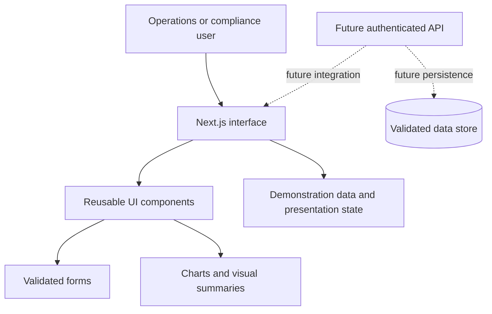

# Architecture

This repository is a frontend interface concept for waste circularity and extended-producer-responsibility (EPR) workflows. It explores how users might navigate operational information; it is not a complete compliance calculation or reporting service.

## Current boundary

- Next.js and React render the interface.
- Reusable components provide layout, navigation, forms, and visual summaries.
- Form validation is handled in the client application.
- Any sample metrics should be interpreted as demonstration content unless independently validated.

## Production evolution

A production platform would need authenticated roles, verified organization and partner records, traceable evidence, documented calculation methodologies, versioned regulatory rules, audit history, secure persistence, and automated tests. Emissions or recovery claims must be traceable to validated source data and an explicit methodology.

The current frontend should not be represented as live regulatory reporting, certified emissions accounting, or verified compliance.
